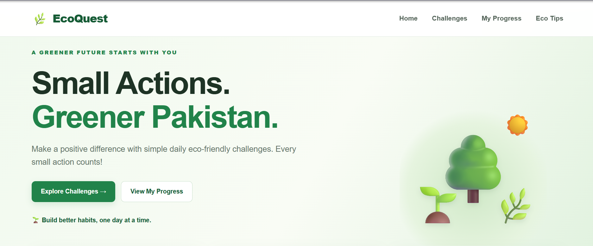
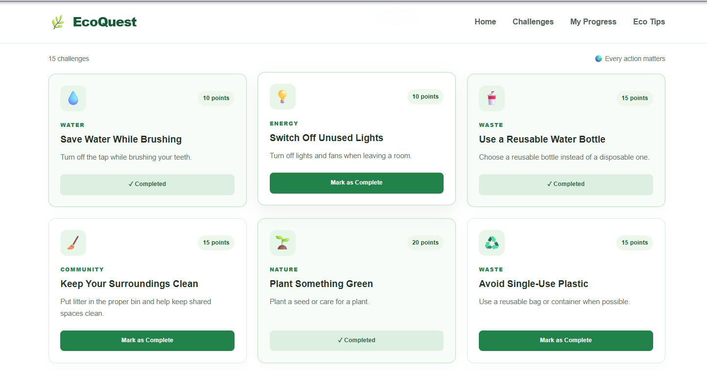
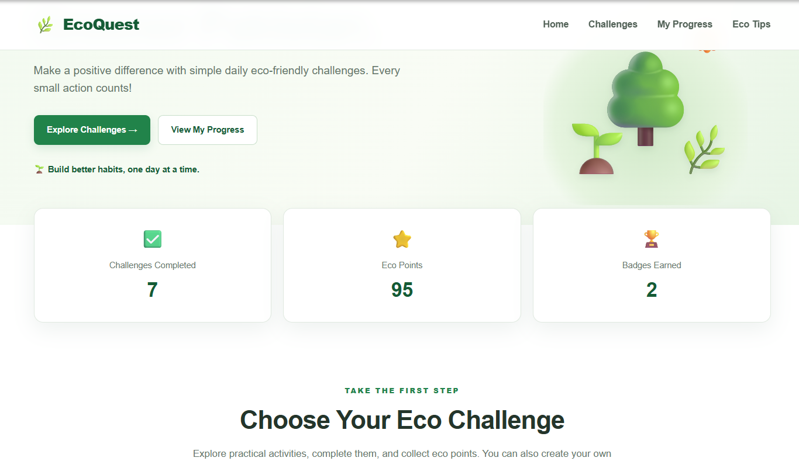

# 🌿 EcoQuest — Small Actions, Greener Pakistan

**A greener future starts with you!**

EcoQuest is a responsive, interactive sustainability website designed to encourage people to adopt eco-friendly habits through simple daily challenges. Its goal is to show how small actions, such as saving water, reducing waste, and protecting nature, can contribute to a cleaner and greener Pakistan.

## 🎯 Project Objective

The objective of EcoQuest is to make environmental awareness engaging and practical. Users can explore sustainability challenges, complete activities, earn points, unlock achievements, and track their progress through an easy-to-use interface.

## ✨ Features

- **Responsive Design:** Works across desktop, tablet, and mobile screens.
- **Eco Challenges:** Includes 15 built-in challenges related to water, energy, waste, nature, and community.
- **Interactive Completion:** Mark challenges as completed and earn eco points.
- **Progress Dashboard:** Track completed challenges, total points, eco levels, and earned badges.
- **Search and Filters:** Find challenges using keywords or category filters.
- **Custom Challenges:** Add, edit, and delete your own challenges.
- **Achievement System:** Unlock badges by completing challenges.
- **Local Storage:** Saves progress in the browser for future visits.
- **Eco Tips:** Provides practical suggestions for environmentally friendly living.

## 🛠️ Technologies Used

- **HTML5:** Structures the website using semantic elements and accessible form controls.
- **CSS3:** Provides styling, layouts, Flexbox, Grid, transitions, and responsive media queries.
- **JavaScript:** Handles events, DOM manipulation, search, filtering, challenge management, points, and achievements.
- **Git and GitHub:** Support version control, project hosting, and source-code management.
- **GitHub Pages:** Can be used to publish the website online.

## 📁 Project Structure

```text
EcoQuest/
├── index.html
├── style.css
├── script.js
├── assets/
└── README.md
```

The `assets` folder is available for optional images, logos, and screenshots.

## 🚀 How to Run the Project

1. Download or clone the project repository.
2. Open the `EcoQuest` folder in Visual Studio Code.
3. Open `index.html` in a browser, or use the Live Server extension.
4. Explore the challenges and test the interactive features.

No additional libraries or frameworks are required.

## 📸 Screenshots

### 🏠 Home Page


### 🌱 Challenges Section


### 🏆 Progress Dashboard



## 🔗 Project Links

- **GitHub Repository:** [Insert your repository URL here]
- **Live Website:** [Insert your GitHub Pages URL here]

Replace these placeholders with your actual links before submission.

## 🧠 Challenges and Learning Outcomes

During development, connecting HTML elements with JavaScript functionality and ensuring that styles and scripts load correctly were important areas to test. Testing these components helped develop a better understanding of debugging, file organization, and the relationship between HTML, CSS, and JavaScript.

This project provided practical experience with DOM manipulation, event listeners, form validation, arrays, objects, filtering, browser storage, and responsive web design. It also reinforced the importance of testing interactive features and keeping project files organized.

## 🔮 Future Improvements

Possible future enhancements include daily challenge reminders, a leaderboard, additional eco-friendly activities, environmental impact statistics, and cloud-based user accounts.

## 🌍 Our Mission

**Small actions. Greener Pakistan.**

EcoQuest encourages everyone to take meaningful steps toward a cleaner, healthier, and more sustainable future.

---

*Created as a web development project to promote environmental awareness and practical sustainability habits.*